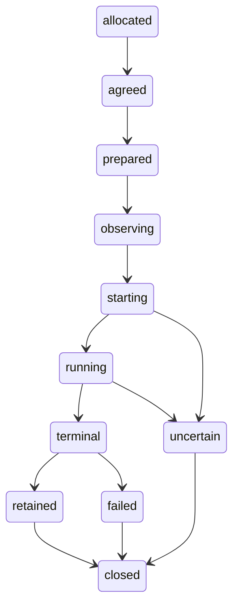

# HealthBench container Eval

`python -m synth_optimizers.eval.healthbench` is an installed example over the
existing Eval candidate, seed, result and selection contracts. It consumes the
Containers package/build descriptor and shared OCI executor. This profile requires
the Containers candidate exposing `package_build` and `oci_trial`; the qualified
wheel and its digest are retained with the witness. It performs no Rust build.

Freeze before provider execution:

```sh
python -m synth_optimizers.eval.healthbench freeze \
  --evals-root /path/to/evals --dataset /inputs/healthbench.jsonl \
  --prices /inputs/openrouter-models.json --wheels /inputs/linux-wheelhouse \
  --base-image python@sha256:BASE_DIGEST --platform linux/arm64 \
  --output /releases/healthbench2-eval-1.1.0
synth-containers package plan /releases/healthbench2-eval-1.1.0/container-package.toml
synth-containers package build /releases/healthbench2-eval-1.1.0/container-package.toml \
  --output /receipts/build
python -m synth_optimizers.eval.healthbench run \
  --artifact /receipts/build/artifact.json --bundle /releases/healthbench2-eval-1.1.0 \
  --home /results/healthbench --run-id healthbench-witness
```

Provide `OPENROUTER_API_KEY` through the authorized environment. Plans and archives
contain a credential reference, never its value. The build uses an offline,
content-addressed wheelhouse. Dataset, prompt, local grader source/protocol,
routes, price snapshot, token ceilings and panels are frozen. The native profile
uses `healthbench.eval-protocol.v2`; no proposer runs.
The final panel remains unobserved. Row identity, rather than split labels,
establishes disjointness. The custom judge is not reference-protocol-equivalent.

Read-only observers:

```sh
python -m synth_optimizers.eval.healthbench watch --home /results/healthbench --run-id healthbench-witness
python -m synth_optimizers.eval.healthbench read --home /results/healthbench --run-id healthbench-witness
python -m synth_optimizers.eval.healthbench reconcile --home /results/healthbench \
  --run-id healthbench-witness --output /receipts/provider-charges.json
```

The TTY view reserves at most ten rows and a fixed status area on the right;
pipes have plain output. `read` checks every adopted artifact digest. Repeating
`run` on a committed result reads it without compute. An active controller holds
an exclusive home lock; another invocation observes the original run. A dead
controller with an unresolved operation refuses execution restart rather than
discarding evidence or resetting a provider budget. No detached controller or
checkpoint continuation is offered. `reconcile` reads the original generation
IDs from OpenRouter; it never submits a completion.

The retained local acceptance witness is report-only. A development installation
snapshot includes the existing native extension, which Eval does not call; this
is not a new native build, published optimizer wheel, hosted qualification or
optimization-uplift result. The broader v0.24 acceptance matrix stays independent.

## Native lifecycle and events

The v1.1 adapter directly registers the frozen policy, prepares a native child,
opens SSE and receives the subscription control before dispatching `POST /rollouts`.
It does not use the GEPA compatibility `/rollout` endpoint. Native status and reward
remain authoritative; the adapter journal records its own custody:



`lifecycle.jsonl` and `operation.json` retain ordered transitions and stable run,
attempt, child and stream identities. `events.jsonl` contains original native
envelopes. `native-cursor.json` is published only after event fsync; a reader can
replay a partially committed page without duplicating evidence. Sequence gaps,
conflicting replays, wrong cursor scopes/history and unavailable journals refuse.
The final closed high-water/chain must match the native trace seal and terminal
reference. SSE history, including a deliberate live disconnect and scoped
Last-Event-ID reconnect, must match the independently paged native history.

The witness replays the same start, refuses a changed-identity start, and checks
that these operations plus reward readback do not add provider calls. A lost start
response is reconciled only against the original child. Completed native results
also survive a server restart in provider-free HTTP tests. An unresolved execution
restart refuses rather than issuing new compute or resetting budgets.

```sh
python -m synth_optimizers.eval.healthbench cancel --home /results/healthbench --run-id healthbench-witness
```

Cancellation delegates to Eval's existing owned OCI supervisor. This HealthBench
profile has no per-rollout native cancellation API. When its container is killed,
the adapter's last native state can remain `running`; the retained supervisor
receipt records cancellation and confirmed container absence separately. Partial
events/cursors and outstanding provider reservations are retained, and a native
terminal cancellation event is never fabricated.

The builder records the inspected OCI index/manifest/config kind and actual
platform. Local containerd image IDs can be OCI index digests; they must not be
labeled as config digests. Digest-pinned local references do not claim registry
publication.

Native journals are explicitly bound to `/output/native-storage`. The local
witness reopens copies of those retained journals in two fresh, network-disabled
container processes per row, replays the original start, and checks zero native
compute calls. Original output hashes must remain unchanged. This tests the actual
adapter entrypoint and its storage binding, in addition to HTTP-level fixtures.
Observed prompt/rubric identities are checked against the frozen rows; reward is
recomputed from the retained judgments and frozen signed rubric weights. Split
names alone never establish row disjointness.
